[🌐 English](https://github.com/Daagudelop/Daagudelop/blob/main/README.md) · **🇪🇸 Español**

*"Me encanta hacer videojuegos, aprender y ponerme a prueba."*

<!--  -->

---

## 🧑‍💻 Sobre mí

Estudiante de séptimo semestre de Ingeniería de Sistemas y Computación en la **Universidad Nacional de Colombia, sede Bogotá**. Desde hace tres años creo videojuegos y experiencias interactivas para **PC, móvil, VR, MR y AR**, y me gusta ir a fondo: un motor Vulkan con motion matching, herramientas defensivas de ciberseguridad y FreeRTOS sobre hardware propio.

Soy uno de los organizadores de **Un-Games**, el grupo estudiantil de desarrollo de videojuegos de mi universidad, donde participo en game jams y en proyectos de equipo que duran meses o incluso años.

<picture>
  <source media="(prefers-color-scheme: dark)" srcset="https://raw.githubusercontent.com/Daagudelop/Daagudelop/output/github-snake-dark.svg" />
  <source media="(prefers-color-scheme: light)" srcset="https://raw.githubusercontent.com/Daagudelop/Daagudelop/output/github-snake.svg" />
  
</picture>

---

## 🎯 En qué trabajo

| 🎮 Gamedev, Experiencias Digitales y Computación Visual | 🛡️ Ciberseguridad | 🔌 Sistemas Embebidos |
| :--- | :--- | :--- |
| Programación de gameplay, experiencias VR/XR, VFX y shaders, gráficos en tiempo real y animación de personajes. | Herramientas defensivas y de detección para roles SOC N1 / seguridad junior, y un home lab para simular ataques controlados. | Firmware en tiempo real sobre ESP32 con FreeRTOS y proyectos en una PCB propia. |

---

## 🧰 Tecnologías

**🎮 Gamedev y XR**

**🖥️ Gráficos y programación de motores**

**🛡️ Seguridad**

**🔌 Embebidos**

**🛠 Herramientas**

🗣 **Idiomas:** Español · Inglés (B2)

---

## 🚀 Proyectos destacados

### 🎮 Gamedev, Experiencias Digitales y Computación Visual

#### ⭐ [Motion Matching — Game Engine Project](https://github.com/Daagudelop/MotionMatching-GameEngineProject)
`C++` `Vulkan` `GLSL` `glTF`

🎓 **Mi proyecto de tesis actual.** Extensión de [Little Vulkan Engine](https://github.com/blurrypiano/littleVulkanEngine) que añade **animación esquelética con skinning en GPU** y un sistema de **motion matching** para controlar un personaje en tiempo real. Incluye una base de datos de 27 características, búsqueda basada en trayectoria, root motion, steering automático e **inertialization** para transiciones suaves. El núcleo de animación y motion matching es independiente de Vulkan.

<!-- Agrega una captura real del motor: 

 -->

#### 🎯 [Platformer Game Example](https://github.com/Daagudelop/Platformer-Game-Example)
`Unity` `C#` `Input System` `URP 2D`

Controlador de jugador 2D **modular al estilo Celeste**: correr, salto de altura variable, coyote time, input buffer, wall slide / wall jump, dash con hit-stop y fast fall. Cada mecánica es un componente independiente y todos los parámetros de "game feel" viven en `ScriptableObject`s, así que se pueden cambiar presets sin tocar código.

#### 🧠 [Xcom-Like](https://github.com/Daagudelop/Xcom-Like)
`Unity` `C#` `NavMesh` `Cinemachine` `Input System`

**Prototipo de juego táctico** en grid con dos modos. En **exploración** controlas un escuadrón estilo RTS (selección por caja, movimiento en formación, inventario por soldado). En **combate** los equipos juegan por turnos, se mueven por casillas sobre el NavMesh y usan habilidades por entidad (alcance de movimiento por BFS, formas de ataque definidas como `ScriptableObject`s). Incluye además un programador de acciones por turno y un object pooler.

<!-- Agrega una captura: 

 -->

#### 📘 [TesisPanthorea — Juego serio de decisiones](https://github.com/Daagudelop/TesisPanthorea)
`Unity` `C#` `Ollama` `LLM local` `URP`

**Juego serio** para registrar y evaluar decisiones. El jugador describe una decisión y responde tres bloques de preguntas; el juego calcula qué tan **eficaz** y **eficiente** fue, cuánto la afectaron los **sesgos cognitivos** y en qué **cuadrante de la matriz de Eisenhower** cae. Un motor de puntuación en C# puro hace todos los cálculos, mientras un **LLM local (Ollama)** redacta las explicaciones, puede generar las preguntas y conversa con el jugador como facilitador. Un asistente animado reacciona al resultado y todo funciona sin conexión.

Soy **coautor** de este software, desarrollado dentro de un **trabajo de grado**.

---

### 🛡️ Ciberseguridad

#### [CyberSecurityLab](https://github.com/Daagudelop/CyberSecurityLab)
`Python` `Bash` `Wazuh` `Kali` `MITRE ATT&CK` `NIST`

Portafolio defensivo de nivel inicial para **roles SOC N1 / seguridad junior**, pensado para usarse solo en sistemas propios o autorizados:

- **Detector de fuerza bruta SSH** (MITRE T1110) · **Auditor de contraseñas** (NIST 800-63B)
- **Monitor de integridad de archivos** · **Auditoría de hardening Linux** (CIS)
- **Analizador de cabeceras de phishing** (T1566) · **Verificador de puertos**
- ⭐ **Mini-SOC Lab:** home lab con Wazuh, Ubuntu y Kali donde ejecuto ataques controlados y documento detección, correlación y respuesta a incidentes (NIST SP 800-61).

---

### 🔌 Sistemas Embebidos

#### [Embedded Projects](https://github.com/Daagudelop/Embedded-Projects)
`C++` `ESP32-S3` `FreeRTOS` `Arduino`

Práctica de **FreeRTOS** sobre ESP32: tareas y prioridades, semáforos binarios, task notifications, colas, event groups, mutex e ISR. Cierra con proyectos completos en una **PCB propia**: un voltímetro con OLED (0–20 V) y un generador PWM controlado por serial.

---

## 🧭 Experiencia destacada

| Cuándo | Qué |
| :--- | :--- |
| **Jul 2025 – hoy** | **Ethos Interstice**: proyecto institucional con la UNAD (Colombia); experiencia inmersiva en VR con uso de APIs en Unity. Participación en **The Rookies 2026** → [ver entrada](https://www.therookies.co/entries/52800) |
| **Abr – Jul 2025** | **Numeria VR**: programador / VFX artist / game designer en un proyecto institucional de experiencias inmersivas VR para la iniciativa Numeria → [jugar en itch.io](https://daagudelop.itch.io/numeria-vr) |
| **Ago 2022 – hoy** | **Proyectos personales y game jams** en [itch.io](https://daagudelop.itch.io/), y organizador del grupo estudiantil **Un-Games** de la Universidad Nacional de Colombia |

---

## 📫 Contacto

📧 **daagudelp@unal.edu.co**
🎮 **itch.io:** [daagudelop.itch.io](https://daagudelop.itch.io/)
📍 Bogotá, Colombia

