**🌐 English** · [🇪🇸 Español](https://github.com/Daagudelop/Daagudelop/blob/main/README.es.md)

*"I love making games, learning, and putting myself to the test."*

<!--  -->

---

## 🧑‍💻 About me

Systems & Computing Engineering student (7th semester) at **Universidad Nacional de Colombia, Bogotá**. For the past three years I've been building games and interactive experiences for **PC, mobile, VR, MR and AR**, and I like going deep: a Vulkan engine with motion matching, defensive security tooling, and FreeRTOS on custom hardware.

I'm one of the organizers of **Un-Games**, the student game-dev group at my university, where I take part in game jams and long-running team projects.

<picture>
  <source media="(prefers-color-scheme: dark)" srcset="https://raw.githubusercontent.com/Daagudelop/Daagudelop/output/github-snake-dark.svg" />
  <source media="(prefers-color-scheme: light)" srcset="https://raw.githubusercontent.com/Daagudelop/Daagudelop/output/github-snake.svg" />
  
</picture>

## 🧭 Experience highlights

| When | What |
| :--- | :--- |
| **Jul 2025 – today** | **Ethos Interstice**: institutional project with UNAD (Colombia); an immersive VR experience using APIs in Unity. Entry in **The Rookies 2026** → [view entry](https://www.therookies.co/entries/52800) |
| **Apr – Jul 2025** | **Numeria VR**: programmer / VFX artist / game designer on an institutional project creating immersive VR experiences for the Numeria initiative → [play on itch.io](https://daagudelop.itch.io/numeria-vr?secret=ykiu8wZjmrN6CV9T96wRcN5PjAk) |
| **Aug 2022 – today** | **Personal projects & game jams** on [itch.io](https://daagudelop.itch.io/), and organizer of the **Un-Games** student group at Universidad Nacional de Colombia |

---

---

## 🎯 What I work on

| 🎮 Game Dev, Digital Experiences & Visual Computing | 🛡️ Cybersecurity | 🔌 Embedded Systems |
| :--- | :--- | :--- |
| Gameplay programming, VR/XR experiences, VFX and shaders, real-time graphics and character animation. | Defensive tooling and detection for SOC L1 / junior security roles, plus a home lab for controlled attack simulations. | Real-time firmware on ESP32 with FreeRTOS and projects on a custom PCB. |

---

## 🧰 Tech stack

**🎮 Game dev & XR**

**🖥️ Graphics & engine programming**

**🛡️ Security**

**🔌 Embedded**

**🛠 Tools**

🗣 **Languages:** Spanish · English (B2)

---

## 🚀 Featured projects

### 🎮 Game Dev, Digital Experiences & Visual Computing

#### ⭐ [Motion Matching — Game Engine Project](https://github.com/Daagudelop/MotionMatching-GameEngineProject)
`C++` `Vulkan` `GLSL` `glTF`

🎓 **My current undergraduate thesis project.** An extension of [Little Vulkan Engine](https://github.com/blurrypiano/littleVulkanEngine) that adds **skeletal animation with GPU skinning** and a **motion matching** system to drive a character in real time. It includes a 27-dimension feature database, a trajectory-based search, root motion, automatic steering and **inertialization** for smooth transitions. The animation and motion matching core is independent of Vulkan.

<!-- Add a real capture of the engine: 

 -->

#### 🎯 [Platformer Game Example](https://github.com/Daagudelop/Platformer-Game-Example)
`Unity` `C#` `Input System` `URP 2D`

A modular, **Celeste-style 2D player controller**: run, variable-height jump, coyote time, input buffering, wall slide / wall jump, dash with hit-stop and fast fall. Each mechanic is an independent component and all "game feel" parameters live in `ScriptableObject`s, so presets can be swapped without touching code.

#### 🧠 [Xcom-Like](https://github.com/Daagudelop/Xcom-Like)
`Unity` `C#` `NavMesh` `Cinemachine` `Input System`

A grid-based **tactics game prototype** with two modes. In **exploration**, you control a squad RTS-style (box selection, formation movement, per-soldier inventory). In **combat**, teams take turns, move across grid cells on the NavMesh and use per-entity abilities (BFS movement range, attack shapes defined as `ScriptableObject`s). It also includes a turn scheduler and an object pooler.

<!-- Add a capture: 

 -->

#### 📘 [TesisPanthorea — Decision-Making Serious Game](https://github.com/Daagudelop/TesisPanthorea)
`Unity` `C#` `Ollama` `Local LLM` `URP`

A **serious game** for recording and evaluating decisions. The player describes a decision and answers three blocks of questions; the game computes how **effective** and **efficient** it was, how much **cognitive biases** affected it, and which **Eisenhower-matrix** quadrant it belongs to. A pure-C# scoring engine does all the math, while a **local LLM (Ollama)** writes the explanations, can generate the questions and can chat with the player as a facilitator. An animated assistant reacts to the result, and everything runs offline.

I co-authored this software as part of an **undergraduate degree project**.

---

### 🛡️ Cybersecurity

#### [CyberSecurityLab](https://github.com/Daagudelop/CyberSecurityLab)
`Python` `Bash` `Wazuh` `Kali` `MITRE ATT&CK` `NIST`

An entry-level defensive security portfolio for **SOC L1 / junior roles**, meant to be used only on systems I own or am authorized to test:

- **SSH brute-force detector** (MITRE T1110) · **Password auditor** (NIST 800-63B)
- **File integrity monitor** · **Linux hardening audit** (CIS)
- **Phishing email header analyzer** (T1566) · **Port checker**
- ⭐ **Mini-SOC Lab:** a home lab with Wazuh, Ubuntu and Kali where I run controlled attacks and document detection, correlation and incident response (NIST SP 800-61).

---

### 🔌 Embedded Systems

#### [Embedded Projects](https://github.com/Daagudelop/Embedded-Projects)
`C++` `ESP32-S3` `FreeRTOS` `Arduino`

Hands-on **FreeRTOS** practice on ESP32: tasks and priorities, binary semaphores, task notifications, queues, event groups, mutexes and ISRs. It closes with complete projects on a **custom PCB**: an OLED voltmeter (0–20 V) and a serial-controlled PWM generator.

---

## 📫 Let's connect

📧 **daagudelp@unal.edu.co**
🎮 **itch.io:** [daagudelop.itch.io](https://daagudelop.itch.io/)
📍 Bogotá, Colombia

